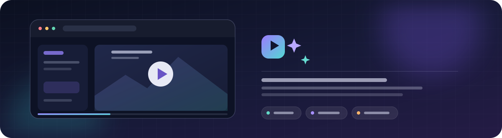

<div align="center">
  
  <h1>Brag فارسی</h1>
  <p dir="rtl"><strong>ویدیوی معرفی فارسی با نمایش کارکردهای واقعی محصول</strong></p>
  <p>
    <a href="LICENSE"></a>
    
    
    
    
    
  </p>
</div>

Brag فارسی، نسخهٔ فارسیِ [Brag](https://github.com/latent-spaces/brag) و مهارتی برای دستیارهای کدنویسی است. نشانی سایت یا مسیر کد محصول را به آن بده. اگر سایت در دسترس باشد، مسیر اصلی کار با محصول را بررسی می‌کند؛ سپس بر پایهٔ ویژگی‌هایی که در سایت یا کد پیدا کرده، ویدیوی معرفی فارسی می‌سازد. نوشته‌های ویدیو راست‌به‌چپ چیده می‌شوند و گفتار آن فارسی است.

## نصب و اجرا

دستور زیر مهارت را برای Claude Code، Codex، Gemini CLI و Qwen Code نصب می‌کند. برای نصب در یک ابزار، نام بقیه را از دستور بردار:

```sh
npx skills add plilian/brag-farsi --skill brag -a claude-code -a codex -a gemini-cli -a qwen-code
```

پس از نصب، در پوشهٔ پروژه این درخواست را بنویس:

```text
/brag https://example.com
```

برای بررسی کد یک پروژهٔ محلی:

```text
/brag برای پروژهٔ ./path/to/product یک ویدیوی معرفی فارسی بساز.
```

## این مهارت چه می‌کند؟

۱. سایت یا کد محصول را بررسی می‌کند و بخش معرفی را از محیط اصلی محصول جدا می‌کند.
۲. راه اصلی کار با محصول و ویژگی‌های آن را پیدا می‌کند؛ چیزی را که در سایت یا کد ندیده، وارد متن نمی‌کند.
۳. متن گویندگی و نماهای ویدیو را آماده می‌کند و کارکرد محصول را در صحنه‌ها نشان می‌دهد.
۴. پیش‌نمایش را از نظر درست‌نویسی، خوانایی، هماهنگی صدا و درستی اطلاعات بازبینی می‌کند؛ پس از تأیید تو، فایل MP4 نهایی را می‌سازد.

این مهارت خرید یا پرداخت انجام نمی‌دهد و داده‌های محصول را تغییر نمی‌دهد. اگر بخشی از محصول به ورود نیاز دارد، فقط با دسترسی مجاز یا حساب نمایشی آن را بررسی می‌کند.

## صدای گوینده

برای گویندگی دو گزینه وجود دارد:

- **مانا (Mana):** برای ساخت گفتار از سرویس عمومی مانا در Hugging Face استفاده می‌کند؛ پس متن گویندگی به آن سرویس فرستاده می‌شود. مجوز فعلی مدل استفاده از آن را به پژوهش و توسعه محدود می‌کند. برای استفادهٔ تجاری، از صاحب مدل اجازه بگیر.
- **امیر (Amir):** صدای مردانه‌ای است که با Piper روی دستگاه ساخته می‌شود. مدل صدا در نخستین اجرا دانلود می‌شود و متن گویندگی به سرویس بیرونی فرستاده نمی‌شود.

برای هیچ‌کدام به کلید API یا پرداخت نیاز نداری.

صدای مانا پیش‌فرض است. برای انتخاب امیر یا خاموش‌کردن صدا، موسیقی یا افکت‌ها، گزینهٔ دلخواه را به درخواستت اضافه کن:

```text
/brag --voice amir
/brag --no-voice
/brag --no-music
/brag --no-sfx
```

## نوشتار و قلم فارسی

- ویدیو نوشته‌ها و گفتار فارسی دارد. نام برند، نشانی وب و عبارت‌های فنی لازم به شکل اصلی می‌مانند.
- نوشته‌ها راست‌به‌چپ چیده می‌شوند و نشانه‌گذاری فارسی رعایت می‌شود. برای درست‌خواندن واژه‌های چندپهلو، اعراب لازم به متن گفتار افزوده می‌شود.
- قلم پیش‌فرض **Vazirmatn** است و فایل و مجوزش همراه مهارت قرار دارند. برای تیتر می‌توانی **Estedad**، **Shabnam**، **Sahel** یا **Lalezar** را انتخاب کنی.
- جزئیات چیدمان فارسی و ترکیب نوشته‌های فارسی و لاتین در [راهنمای نوشتار فارسی](skills/brag/references/persian-typography.md) آمده است.

## پیش‌نیازهای ساخت ویدیو

- یکی از این دستیارها: Claude Code، Codex، Gemini CLI یا Qwen Code؛
- Node.js نسخهٔ ۲۲ یا بالاتر و ابزار Hyperframes؛
- FFmpeg؛
- پایتون (Python) نسخهٔ ۳٫۱۱ یا بالاتر برای اجرای ابزارهای ساخت صدا؛
- بستهٔ `gradio_client` برای صدای مانا یا `piper-tts` برای صدای امیر.

فایل نهایی با نام `brag.mp4` در پوشهٔ `brag-output/` قرار می‌گیرد. اگر از قبل پوشه‌ای با این نام باشد، برای اجرای تازه پوشه‌ای جدا با تاریخ و ساعت ساخته می‌شود.

## مجوزها

کد و راهنماهای این مخزن با مجوز MIT منتشر شده‌اند. این نسخه بر پایهٔ پروژهٔ متن‌باز [Brag](https://github.com/latent-spaces/brag) ساخته شده است. موسیقی‌های همراه مجوز CC BY 4.0 دارند؛ هنگام انتشار ویدیویی که از آن‌ها استفاده می‌کند، نام سازنده را ذکر کن. افکت‌های صوتی CC0 هستند. گفتار، قلم‌ها و ابزارهای وابسته مجوزهای جداگانه دارند. جزئیات در [اطلاعیهٔ مجوزها و نحوهٔ ذکر منابع](THIRD_PARTY_NOTICES.md) آمده است.

---

<p align="center" dir="rtl">اگر به ایرادی برخوردی، در بخش Issues مخزن گزارشش کن. برای پیشنهاد تغییر هم Pull Request بفرست.</p>
